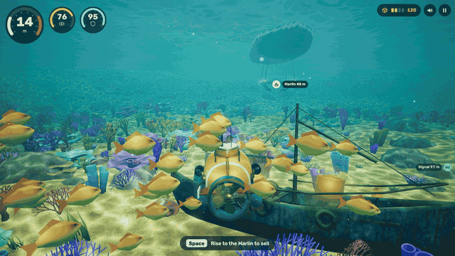
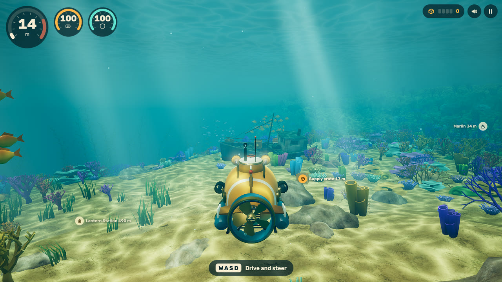
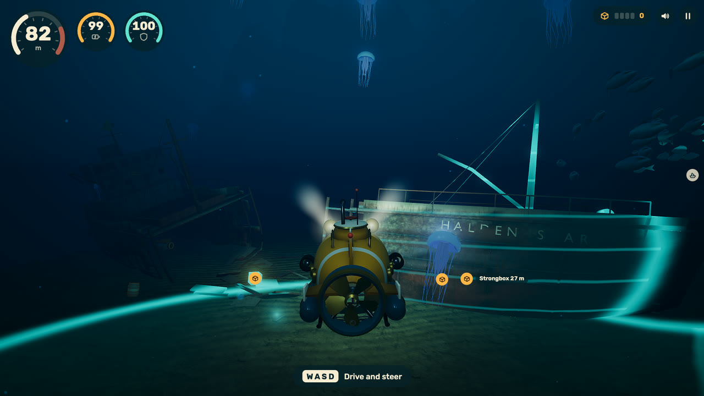
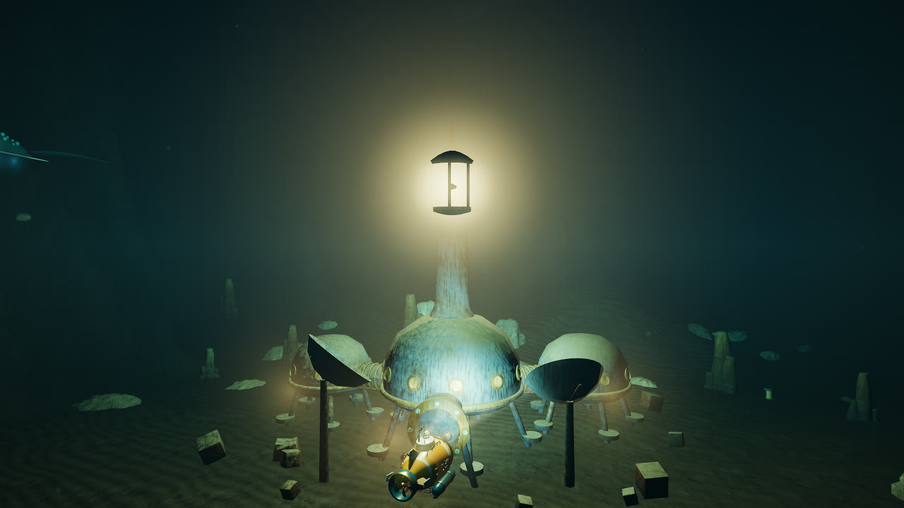

# Deep Salvage

An underwater exploration game in Babylon.js and TypeScript. Steer a small yellow submarine along a coral reef, find wrecks with sonar, sell what you lift and upgrade your way down to a dark station in the trench.

[](https://oryn.dev/games/deep-salvage)

**[Play it in your browser](https://oryn.dev/games/deep-salvage)**, no download needed. It also runs on phones.

## What is inside

- One continuous dive through four zones: Coral Reef, Kelp Forest, Wreck Field and The Trench
- Six wrecks with cargo and a logbook page each, and an ending 229 metres down
- Sonar, a grabbing arm, battery, hull pressure and a small hold: the choices of every dive
- Six upgrades with three levels each (hull, battery, lights, sonar, arm, hold)
- Underwater light, caustics, kelp, fish schools and jellyfish in custom shaders
- Runs on WebGPU, falls back to WebGL, and plays on phones

<p>
  
  
  
</p>

## Start it on your computer

You need [Node.js](https://nodejs.org) 20.19 or newer.

```bash
git clone https://github.com/oryn-dev/babylonjs-submarine-game.git
cd babylonjs-submarine-game
npm install
npm run dev
```

Then open the address it prints, usually http://localhost:5173.

`npm run build` writes the finished game to `dist/`. It is a plain static folder, so you can put it on any web host or upload it to itch.io as an HTML game.

## Controls

| | Keyboard and mouse | Gamepad | Touch |
| --- | --- | --- | --- |
| Drive and steer | W A S D | Left stick | Stick |
| Look | Mouse | Right stick | Drag |
| Up / down | Space / Shift or C | A / B | Up and Down buttons |
| Grab, dock, use | E or click | Y | Claw button |
| Sonar | F | X | Sonar button |
| Pause | Esc or P | Start | Pause button |

## Change it

| File | What it does |
| --- | --- |
| `src/game/game.ts` | Where the game starts |
| `src/game/data/wrecks.ts` | Where the wrecks lie, what they hold and what their logs say |
| `src/game/sub/` | The submarine, its arm, lamps and effects |
| `src/game/world/` | Terrain, plants, animals and wrecks |
| `src/game/gfx/` | Water and caustics shaders |
| `src/game/hud/` | Gauges, markers and the workshop |
| `game/tuning.json` | 97 values such as thrust, drain, prices and upgrade steps |
| `game/look.json` | Sky, light, fog and post effects |
| `public/assets/` | Models, textures, sounds and fonts |
| `src/oryn/` | A small base around Babylon.js: start, light, input, sound, saves, settings |

`npm run typecheck` checks the types.

## Open it in Oryn

The project follows the layout of [Oryn](https://oryn.dev), so you can open it there and keep building by chat, with the game running next to it.

1. Sign in at [oryn.dev](https://oryn.dev) and start a new game.
2. Choose **From GitHub** in the menu next to the prompt.
3. Paste `https://github.com/oryn-dev/babylonjs-submarine-game` as the public repository URL and press **Import project**.

You get your own copy. This repository stays as it is.

## Make it yours

A few things you could ask for after the import:

- "Add a sunken city with three buildings to salvage below the trench"
- "Give the submarine a torpedo and a giant squid to fear"
- "Let two players dive together and share one hold"

When you like the result, publish it as a page anyone can play, or export it as a [mobile app](https://oryn.dev/mobile-game-maker) for Android and iOS or as a Windows, Mac, Linux or Steam build. Exports need a paid plan, and you publish with your own store accounts.

## More games with source

- [Furnace Choir](https://github.com/oryn-dev/babylonjs-boomer-shooter), a boomer shooter
- [Moth Hour](https://github.com/oryn-dev/babylonjs-bullet-hell), a bullet hell
- [Channel 6: Night Shift](https://github.com/oryn-dev/babylonjs-horror-game), a horror game
- [Tornado Simulator: Storm County](https://github.com/oryn-dev/babylonjs-tornado-simulator), a tornado simulator

## License

The code and our own assets are [MIT](LICENSE): use them, change them, sell what you make. Third-party assets and libraries are listed in [ASSETS.md](ASSETS.md). The Oryn name and logo are not part of the license.
